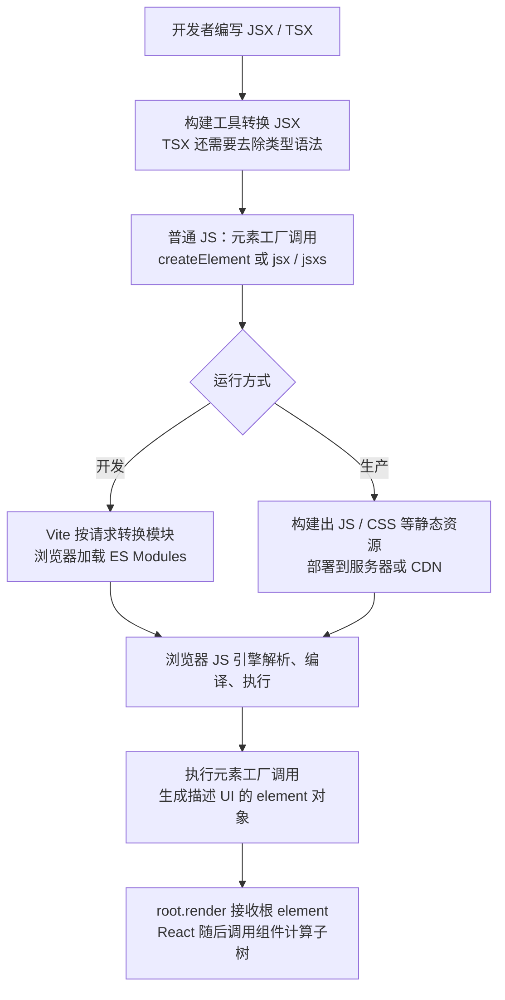
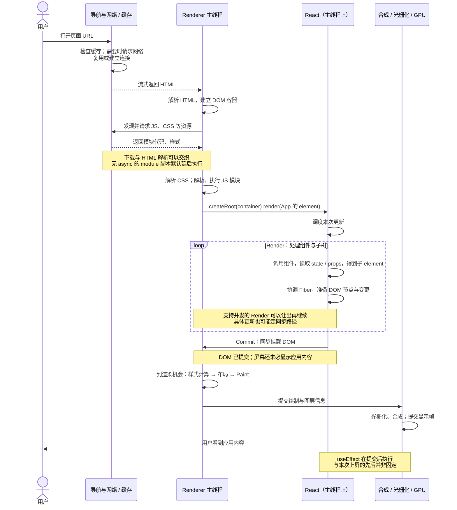
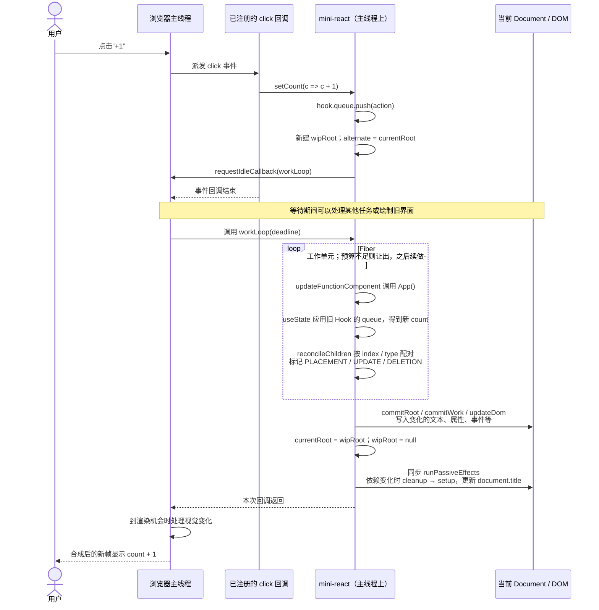
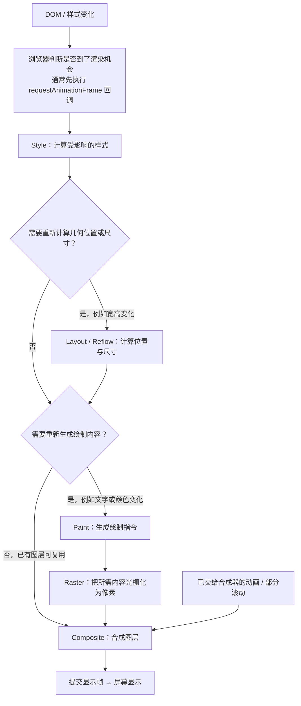
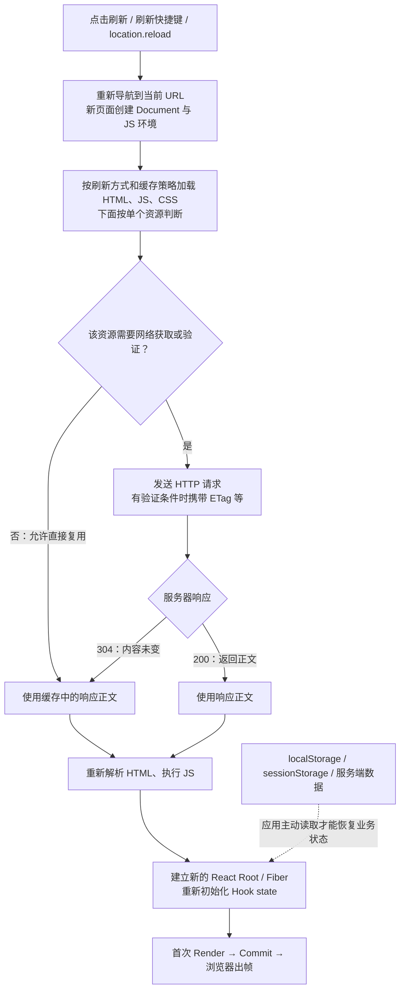
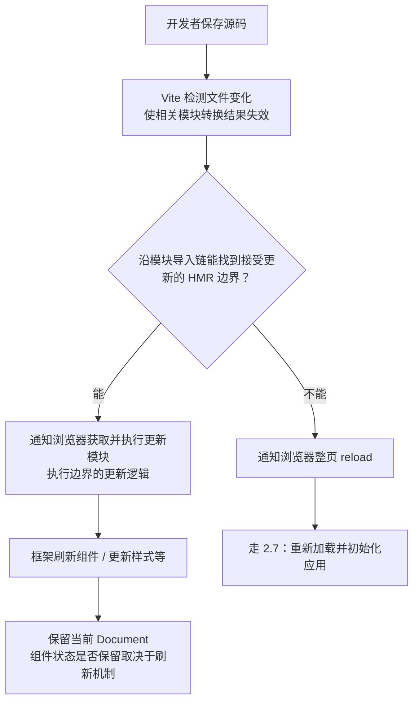

# 浏览器 & 网络基础笔记

这份文档以浏览器、网络和操作系统为主，记录理解"一个 React 项目从用户发请求到页面画出来"这整条链路时绕不开的底层知识。第 2 节补充了从代码到上屏的场景图，并用当前 mini-react 的函数定位实现；具体实现步骤见 [hand-write/tech.md](hand-write/tech.md)。

图解入口：[代码编译](#react-code-transform) → [首次渲染](#react-first-render) → [状态更新](#react-state-update) → [浏览器出帧](#browser-frame)；另见 [页面刷新](#browser-reload) / [开发热更新](#dev-hmr)。

## 1. 事件循环：宏任务 / 微任务 / 渲染的执行顺序

一次完整的循环迭代：

```
1. 从宏任务队列取一个任务并执行
   （输入事件回调、setTimeout/setInterval、postMessage/MessageChannel、网络回调等）
        ↓
2. 清空微任务队列，直到完全清空为止
   （Promise.then/catch/finally、queueMicrotask、MutationObserver）
   —— 这一步不可中断、不可跳过，微任务里产生的新微任务也会在本轮跑完
        ↓
3. 浏览器判断是否到了渲染时机（不是每个宏任务后都渲染，按刷新率约每 16.6ms 一次 @60Hz）
   若是：
     requestAnimationFrame 回调 → 样式计算 → 布局 → 绘制 → 合成
        ↓
4. 若这一帧还有剩余空闲时间：requestIdleCallback 回调
        ↓
回到第 1 步，取下一个宏任务
```

**关键结论**：
- 微任务队列不清空，主线程不会往下走到渲染和 `requestIdleCallback`。如果代码用 Promise 链式递归调度（而不是宏任务），一旦微任务不断产生新微任务，会**持续饿死渲染**，页面卡死不出下一帧——这是微任务和宏任务优先级差异最危险的地方。
- 这也是为什么 React 真正的 Scheduler 包**不用微任务、也不用 `requestIdleCallback`**，而是自己用 `MessageChannel`（宏任务）实现调度：`requestIdleCallback` 在 Safari 不支持、且空闲时机不稳定（主线程一忙可能几百 ms 都不触发一次）；微任务则有饿死渲染的风险。`MessageChannel` 能提供一个行为可控、跨浏览器一致、且能插入优先级调度的宏任务节奏。

### `requestIdleCallback` 的关键参数

- `deadline.timeRemaining()`：本次空闲窗口预计还剩多少毫秒（动态估算值）。
- `deadline.didTimeout`：只有传了 `{ timeout }` 选项，且空闲回调因迟迟没有空闲时间被强制超时触发时才为 `true`。
- **50ms 上限 vs 16.6ms 帧预算**：两者不冲突。16.6ms 管的是"忙"的时候（有动画/rAF循环，浏览器必须按固定节奏出帧，挤给 idle 的时间很紧张）；50ms 是"闲"的时候（没有待渲染内容）单次 idle 回调的独立安全上限，为了保证用户输入能被及时响应而设的规范值，和帧率无关。

### Long Task（长任务）

浏览器性能领域术语，指单次连续占用主线程超过 **50ms** 的同步任务（Chrome DevTools Performance 面板、`PerformanceObserver` 的 `longtask` API 都用 50ms 做阈值）。长任务期间用户点击/输入/滚动完全没有响应。老版本 React（Stack Reconciler）同步递归遍历整棵树就容易退化成长任务；Fiber 把遍历拆成节点级别的小工作单元，配合时间片检查主动让出主线程，就是为了把单次占用时间死死限制在这个阈值以下。

## 2. 从请求到渲染的完整链路（进程/线程级）

### 2.1 浏览器的多进程/多线程架构

| 进程/线程 | 职责 |
|---|---|
| Browser 进程 · UI 线程 | 接收用户输入、地址栏、标签页管理 |
| Browser 进程 / 独立的 Network Service | DNS、TCP/TLS、HTTP 请求响应、缓存策略 |
| Renderer 进程 · 主线程 | HTML/CSS 解析、JS 执行、样式计算、Layout、Paint(生成绘制指令) |
| Renderer 进程 · 合成线程 (Compositor) | 接收主线程提交的图层，管理滚动/合成，调度光栅化 |
| Renderer 进程 · 光栅化线程池 (Raster) | 把绘制指令转成实际位图(tile) |
| Renderer 进程 · Worker 线程 | 每个 Web Worker / Service Worker 一个独立线程 |
| GPU 进程 | 接收光栅化后的纹理，做最终合成，输出到屏幕缓冲区 |

**Site Isolation**：Chrome 对不同站点强制用不同 Renderer 进程（即使同一 tab 内跨域 iframe 也单独开进程）。动机是 Spectre 硬件漏洞曝光后的安全加固——同进程内 JS 理论上能通过侧信道读取同一地址空间里其他站点的内存数据。

**Mojo**：Chrome 自研的跨进程通信框架（替代早期 Chrome IPC），底层结合共享内存 + 消息传递，支撑 Chrome 的多进程/多服务架构（Servicification，如 Network Service 独立成进程）。

<a id="react-to-screen"></a>

### 2.2 从 React 代码到上屏：场景边界

以下按**客户端渲染（CSR）**展开：HTML 提供容器，JS 执行后生成应用内容。服务端已生成应用 HTML 的场景需要另看 SSR / `hydrateRoot`，不能直接套用首次挂载的时序。[R10]

| 所说的“渲染 / 刷新” | 起点 | 是否创建新 Document | 接着看 |
|---|---|---|---|
| 首次打开页面 | 导航并加载 HTML、JS、CSS | 是 | 2.4 |
| React 重新渲染（re-render） | state、父组件传入的 props、context 等更新 | 否 | 2.5 |
| 浏览器绘制新一帧 | DOM、样式、动画、滚动等变化 | 否 | 2.6 |
| 页面刷新（reload） | 刷新按钮、快捷键、`location.reload()` | 是 | 2.7 |
| 开发热更新（HMR） | 保存源码，开发服务器通知浏览器 | 成功热更新时否；整页重载时是 | 2.8 |

<a id="react-code-transform"></a>

### 2.3 代码阶段：JSX 怎样变成浏览器能执行的 JS



**元素对象、Fiber、DOM 是三个层次**：element 描述要显示什么；Fiber 保存 React 的工作和组件状态；DOM 是浏览器的节点。创建 `<App />` 的 element 不会立即调用 `App()`，也不会立即创建它的 DOM。[R1][C3]

经典 JSX 转换输出 `createElement` 调用；自动 JSX runtime 输出 `jsx` / `jsxs` 等调用。两者都由构建工具转换成普通 JS，再交给浏览器执行。[R9]

当前项目使用自定义转换器输出 `createElement(...)`；`src/App.jsx` 已手写这些调用，转换器也能处理其他文件里的 JSX。这里仅表示 JSX 转换链路；当前插件没有完整的 TypeScript 编译能力。[C1]

```jsx
// JSX 输入
<Title text="count: 0" />

// 当前项目转换后的普通 JS
createElement(Title, { text: 'count: 0' })

// 执行上面的调用，只得到描述对象；Title 尚未被调用
// { type: Title, props: { text: 'count: 0', children: [] } }
```

<a id="react-first-render"></a>

### 2.4 首次渲染：从导航、资源加载到应用内容上屏

图中的 React 指真实 React 的 CSR 主链路；React 的调度和组件计算都在 Renderer 主线程执行，Scheduler 不是另一个 JS 工作线程。[R2][R4]



HTML 自带的文本、背景或骨架可能在 React 内容挂载前先被绘制；应用首次渲染也不必等待所有图片下载完。模块脚本不会像无 `defer/async` 的经典脚本一样阻塞 HTML 解析。[R4][R5]

当前项目把上述 React 部分映射为：`main.js` → `render()` → `scheduleWorkLoop()` → `workLoop()` → `performUnitOfWork()` → `commitRoot()`。用 `requestIdleCallback` 分片是 mini-react 的教学实现；不能把真实 React 的每次更新都理解成等待 idle 回调。[C2][C3]

<a id="react-state-update"></a>

### 2.5 状态更新：点击“+1”后，为什么页面会变

以下按**当前 mini-react 代码**绘制。点击按钮会把更新放入 Hook 队列，再启动一轮 Fiber 遍历；同一个 Document 内更新内容，不需要重新加载 HTML 和入口 JS。[C3][C4]



这里有三个边界：

| 边界 | 本项目 / 真实 React 的含义 |
|---|---|
| `setCount()` 返回 | 本项目已入队并注册调度；浏览器中尚未在这个调用里完成本次 DOM 更新 |
| Render 完成 | 算出了新 UI；真实 React 若发现输出无差异，可以不改 DOM |
| Commit 完成 | DOM 更新完成；浏览器是否已上屏要看渲染机会 |

**Effect 时机不要混用**：本项目 `commitRoot()` 直接同步调用 `runPassiveEffects()`，所以在该回调返回前执行；真实 React 的 `useEffect` 通常在非交互更新绘制后执行，交互更新则可能在绘制前执行，不能规定“一定在下一帧之后”。[C5][R3]

本项目由 `updateDom()` 对节点直接调用 `addEventListener`。图里的队列、从根重算、按 index/type 配对也只描述当前实现，不代表真实 React 的全部优化和调度规则。[C4][C6]

<a id="browser-frame"></a>

### 2.6 浏览器出帧：DOM 变化之后还要做什么

这是浏览器阶段，首次挂载、状态更新、页面刷新都可能进入它；CSS 动画或滚动也可以让画面变化，无须先调用 React 组件。[R6]



`transform` / `opacity` 在满足合成条件时可以复用图层，跳过 Layout 和 Paint；不是所有相关变更都保证如此。60Hz 屏幕每次刷新约间隔 16.7ms，但浏览器不保证每个 JS 任务结束都出新帧；没有新内容时也不会重复执行整条流水线。[R6]

<a id="browser-reload"></a>

### 2.7 页面刷新：缓存能复用，为什么 state 仍会重置

这里的刷新指**重新加载当前页面**，不是历史前进/后退中的 BFCache 恢复。新页面创建新的 Document 与 JS 执行环境；HTTP 缓存保存的是资源响应，不保存旧 Fiber 和 Hook 内存。[R7][C2][C4]



普通刷新通常会触发资源再验证；强制刷新通常绕过 HTTP 缓存，具体资源行为受浏览器和缓存策略影响。即使返回 `304`，也只是复用旧的文件正文，**JS 仍重新执行**。DNS 结果和已有连接也可能复用，不必每次重新握手。[R4][R7]

本项目的 `useState(0)` 在新页面里重新初始化，`count` 回到 `0`。旧页面消失不能等同于调用 `root.unmount()`，也不能依赖刷新一定执行 React Effect cleanup；`root.unmount()` 才是 React 提供的主动卸载接口。[C4][C5][R10]

<a id="dev-hmr"></a>

### 2.8 开发热更新：保存文件后，不一定是整页刷新



HMR 是模块更新机制；React Fast Refresh 额外负责组件更新和符合条件时的状态保留。本项目只配置 `myJsxPlugin()`，源码没有 `import.meta.hot.accept`，也没有 React Fast Refresh 插件；因此对现有 JS / JSX 导入链的修改应预期走整页重载，不能预期保留 `count`。这是配置与源码推导，未做本次浏览器实测。[C1][R8]

### 2.9 图中依据：官方文档与当前代码入口

代码定位以 2026-11-23 的当前工作区为准；链接不绑定行号，避免后续迭代后失效。

| 编号 | 依据 | 支撑内容 |
|---|---|---|
| C1 | [vite.config.js](../mini-react/vite.config.js)、[vite-plugin-my-jsx.mjs](../mini-react/tools/vite-plugin-my-jsx.mjs)、[jsx-transform.mjs](../mini-react/tools/jsx-transform.mjs) | 自定义 JSX 转换、插件配置、HMR 边界现状 |
| C2 | [main.js](../mini-react/src/main.js)、[index.html](../mini-react/index.html)、[react.js](../mini-react/src/react.js) | HTML 容器、module 入口、element 工厂与启动 |
| C3 | [render.js](../mini-react/src/render.js)：`render` / `scheduleWorkLoop` / `workLoop` / `performUnitOfWork` | 建立 wipRoot、idle 调度、Fiber 遍历 |
| C4 | [App.jsx](../mini-react/src/App.jsx)、[render.js](../mini-react/src/render.js)：`useState` / `reconcileChildren` | “+1”事件、队列、新 state、当前 diff 规则 |
| C5 | [render.js](../mini-react/src/render.js)：`commitRoot` / `runPassiveEffects` | DOM commit、currentRoot 切换、同步 Effect |
| C6 | [createDom.js](../mini-react/src/createDom.js)：`createDom` / `updateDom` | DOM 节点、属性、直接注册和移除事件 |

官方资料：

- R1：https://react.dev/reference/react/createElement — element 是 UI 描述，创建时不调用组件或创建 DOM。
- R2：https://react.dev/learn/render-and-commit — Trigger → Render → Commit → 浏览器绘制；重新渲染不一定改 DOM。
- R3：https://react.dev/reference/react/useEffect — cleanup/setup、依赖比较、与绘制的时序限制。
- R4：https://developer.mozilla.org/en-US/docs/Web/Performance/Guides/How_browsers_work — 导航、解析、布局、绘制与合成。
- R5：https://developer.mozilla.org/en-US/docs/Web/HTML/Reference/Elements/script — module、async、defer 的加载执行规则。
- R6：https://web.dev/articles/rendering-performance — 像素流水线、刷新率、跳过 Layout / Paint 的条件。
- R7：https://developer.mozilla.org/en-US/docs/Web/HTTP/Guides/Caching — HTTP 缓存、304、普通刷新与强制刷新。
- R8：https://vite.dev/guide/api-hmr — HMR 边界、`hot.accept`、模块更新与整页重载事件。
- R9：https://legacy.reactjs.org/blog/2020/09/22/introducing-the-new-jsx-transform.html — JSX 转换、经典与自动 runtime。
- R10：https://react.dev/reference/react-dom/client/createRoot — CSR / hydration 边界、`root.render` 与主动卸载。

## 3. 网络请求阶段细节

### 3.1 DNS 解析

```
浏览器DNS缓存 → 系统DNS缓存(OS服务) → hosts文件 → 路由器缓存
    → ISP递归DNS服务器 → 根域名服务器 → 顶级域名服务器(TLD) → 权威DNS服务器
```

- 默认走 UDP 53 端口，响应过大（或开启 EDNS）会切 TCP。
- 递归查询 vs 迭代查询：客户端对本地 DNS 是递归查询（一次要结果），本地 DNS 对上游是迭代查询（一层层问）。
- 现代浏览器可能用 **DoH (DNS-over-HTTPS)** / **DoT (DNS-over-TLS)**，直接加密查询、绕开系统 DNS，防止运营商 DNS 劫持/污染。

### 3.2 TCP 三次握手

```
客户端 → SYN → 服务器
客户端 ← SYN+ACK ← 服务器
客户端 → ACK → 服务器
```

面向连接、可靠、基于字节流：靠序列号+确认号保证顺序不丢包，靠滑动窗口做流控，靠慢启动/拥塞避免算法（CUBIC/BBR）控制发送速率。**HTTP/3** 基于 QUIC(UDP) 直接跳过这一步，把连接建立和加密握手合并成一步，还支持连接迁移（WiFi 切 4G 不用重连）。

### 3.3 TLS 握手

TLS 1.3（1-RTT，支持 0-RTT 会话恢复）比 TLS 1.2（2-RTT）握手更快：

- 非对称加密（ECDHE等）只用来协商对称密钥，正文用对称加密（AES-GCM）传输，因为快得多。
- **证书链验证**：逐级验证到根证书，同时检查吊销状态（OCSP/CRL）。
- **SNI (Server Name Indication)**：握手阶段带上域名，让同一 IP 能承载多个 HTTPS 站点。
- **ALPN**：握手过程中顺便协商应用层协议是 HTTP/1.1 还是 HTTP/2，省一次额外往返。

### 3.4 HTTP 版本差异 = 并行度差异

- **HTTP/1.1**：明文文本协议，浏览器对同一域名默认最多 6 个 TCP 连接并行，第 7 个请求要排队；连接内请求基本串行（真实场景很少用 pipelining）。
- **HTTP/2**：二进制分帧，一个 TCP 连接内多个 stream 多路复用，不再受 6 连接数限制；HPACK 压缩头部；但底层仍是 TCP，一旦丢包，**TCP 层的队头阻塞会卡住这条连接上所有 stream**。
- **HTTP/3**：基于 QUIC/UDP，每个 stream 独立控制丢包重传，避免了 TCP 层的队头阻塞。

**并行的本质**：以上"并行"发生在网络线程管理的多个 socket / 多路复用 stream 上（非阻塞 IO，靠操作系统内核的 epoll(Linux)/kqueue(macOS)/IOCP(Windows) 通知数据到达），不占用/不依赖 JS 线程。这意味着"上千个并行请求"不需要上千个线程。**JS 处理这些请求结果的代码（回调/`.then`）依然要排队进主线程单线程执行**——异步（不阻塞主线程等待）和并行（网络层面同时传输）是两回事，两者结合才是前端"快"的根本原因。

### 3.5 Preload Scanner（预加载扫描器）

HTML Parser 遇到没有 `defer/async` 的 `<script>` 会阻塞构建 DOM，但浏览器不会干等——有一个独立的**预加载扫描器**（不是主线程的一部分）会继续往后纯文本扫描剩余 HTML，提前发现 ``、`<link>`、后续 `<script>` 等资源并提前丢给网络线程请求，等真正解析到时资源可能已经到了大半。手写 `<link rel="preload">` 或 Vite/webpack 自动生成的 `<link rel="modulepreload">`，本质就是主动告诉预加载扫描器"提前请求"，把瀑布式请求变成并行请求。

### 3.6 缓存策略

- **强缓存**：`Cache-Control: max-age` / `Expires`，命中不发请求。
- **协商缓存**：`ETag`/`If-None-Match`、`Last-Modified`/`If-Modified-Since`，发请求但服务器可能返回 304（不带 body）。
- React 项目典型配置：JS/CSS bundle 用**强缓存 + 文件名 hash**（如 `main.[contenthash].js`），HTML 用协商缓存或不缓存，保证发新版本时用户能拿到新 HTML 去引用新 hash 的资源。
- 若站点注册了 **Service Worker**，请求会先经过它的 `fetch` 事件（独立 Worker 线程），可拦截返回缓存内容，是 PWA 离线能力的基础。

## 4. React 项目里的资源加载：并行 vs 瀑布

### 4.1 初始 bundle 通常并行

打包器（Vite/webpack）产物一般会用 `<link rel="modulepreload">` 声明 `vendor.js`，配合 `<script type="module">` 的 `main.js`，两者被预加载扫描器同时发现，并行请求。

### 4.2 `React.lazy()` 是经典的瀑布来源

```jsx
const UserProfile = React.lazy(() => import('./UserProfile'))
```

```
main.js 下载完成 → 主线程执行main.js → React开始render
    ↓ render到 <Suspense><UserProfile/></Suspense> 才发现需要该chunk
    ↓ 此时才发起 UserProfile.[hash].js 的请求 —— 第二波请求
    ↓ 请求返回、执行组件代码
    ↓ 若组件内又用 useEffect 请求数据 —— 第三波请求
```

三级瀑布：主 bundle → 路由/组件 chunk → 组件内部数据请求，一波接一波，而非一开始就并行发出。优化的本质都是"提前暴露给预加载扫描器或提前触发 JS 发起请求"——例如 React Router v6.4+/Remix 的 `loader`，在**匹配路由的同时**并行发起该页面的 chunk 请求和数据请求，而不是等组件真正 render 到才触发。

### 4.3 数据请求的三种异步模式（并行度递增）

**fetch-on-render**（老 `useEffect` 模式，最容易瀑布）：组件 render → commit → `useEffect` 才触发请求。父子组件之间如果存在数据依赖（子组件要等父组件的请求结果才能渲染），会形成串行瀑布——父请求完成 → setState → 重新 render → 子组件才出现 → 子组件才发起自己的请求。

**render-as-you-fetch**（Suspense 模式，真正并行）：在还没开始渲染组件之前就发起所有请求，组件 render 时去读取一个"资源句柄"，若未 resolve 则通过 `Suspense` 挂起展示 fallback：

```jsx
// 路由匹配时立刻发起，不等组件渲染到
const userResource = fetchUser(id)    // 立刻发起请求A
const postsResource = fetchPosts(id)  // 立刻发起请求B，和A并行

function Page() {
  return (
    <Suspense fallback={<Loading/>}>
      <UserInfo resource={userResource}/>
      <PostList resource={postsResource}/>
    </Suspense>
  )
}
```

请求 A、B 在 JS 执行到"发起"那一行时同时丢给网络线程，不需要等对方，也不需要等各自组件渲染到——这是"并行请求"在 React 里的正确落地方式。

### 4.4 时间线示例（网络线程与主线程如何交织）

```
t0  主线程：执行main.js，ReactDOM.render启动
t0  网络线程：并行发起 userResource、postsResource 请求
t1  主线程：Render阶段读 userResource → 未resolve → 抛Promise → Suspense捕获 → 显示fallback
t1  主线程：Commit fallback上屏，随后空闲，可处理其他宏任务/输入事件/rAF
t5  网络线程：postsResource 响应到达 → 回调进入主线程任务队列
t5  主线程：Promise resolve回调执行 → 触发React重新调度render
t8  网络线程：userResource 响应到达 → 同样方式回到主线程
t8  主线程：两个数据都齐了 → Suspense不再挂起 → 正式render → Commit → 上屏
```

t1 到 t8 之间主线程完全没有被"等待网络"占用；两个请求在这期间是网络线程/IO 层面真正并行在跑。
